<picture>
  <source media="(prefers-color-scheme: dark)" srcset="assets/banner-dark.svg">
  
</picture>

I build small, self-healing tools that watch, verify and repair themselves. Most of my work lives in private repositories; this page is the window.

<picture>
  <source media="(prefers-color-scheme: dark)" srcset="assets/stats-dark.svg">
  
</picture>

## What I build

- **Automation that keeps itself honest.** Scheduled jobs with health checks, regression tests on both sides of every boundary, and guards that are themselves mutation-tested.
- **Observability that tells the truth.** Dashboards that show what is actually happening, not just what is green, and flag the moment a check starts lying.
- **Local-first tools.** Software that runs on its owner's machine, keeps data private and needs no server.

<picture>
  <source media="(prefers-color-scheme: dark)" srcset="assets/divider-dark.svg">
  
</picture>

## Public work

**[Ariadne](https://github.com/atakansan/ariadne-site)**: a personal Google Drive organizer that maps every folder into ten named rooms, finds duplicates and clutter, and moves files only after its owner approves the plan. Every change is reversible.

## Principles

1. **Root cause before fix.** No retries, sleeps or silenced checks without evidence.
2. **Verify the measurement.** A green check proves nothing until you know the check itself is honest.
3. **Security first.** No secrets in code, least privilege, every change reviewed before it goes public.
4. **Set and forget.** A fix is done when it is tested, guarded and needs no follow-up.
5. **Accessible by default.** Semantic HTML, visible focus, light and dark themes, reduced motion respected.

<picture>
  <source media="(prefers-color-scheme: dark)" srcset="assets/divider-dark.svg">
  
</picture>

Every graphic on this page is hand-built SVG served from this repository: no trackers, no third-party widgets.
